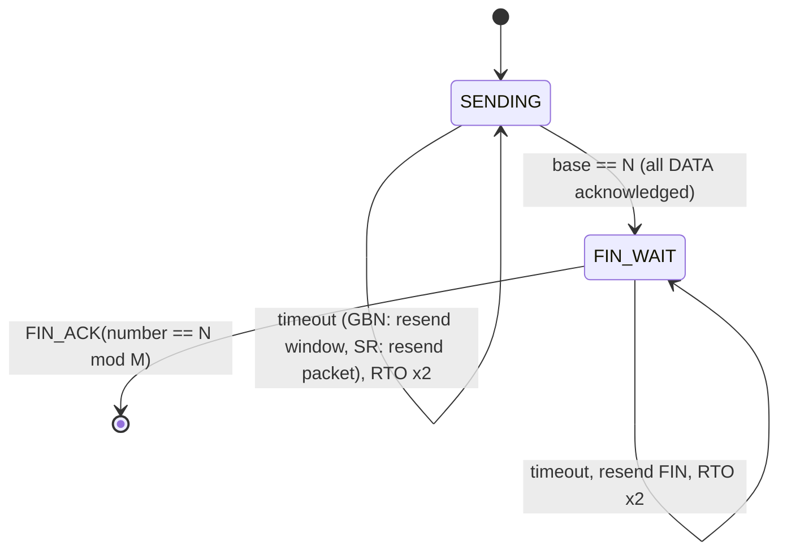
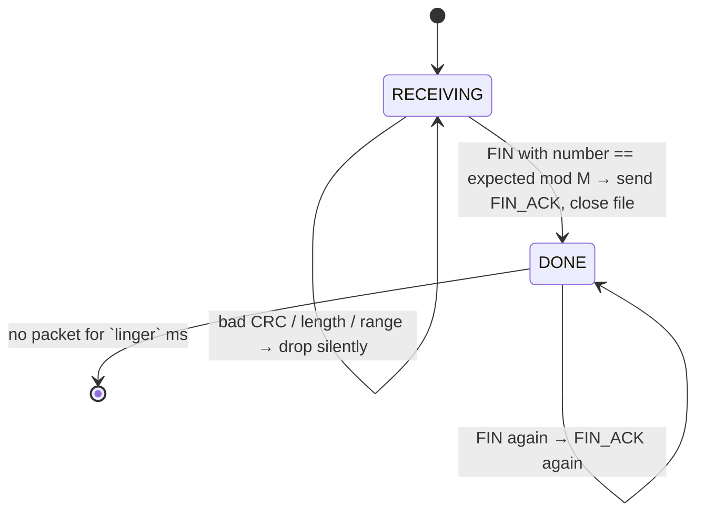
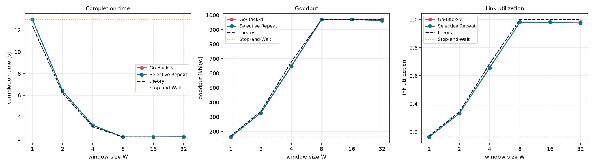
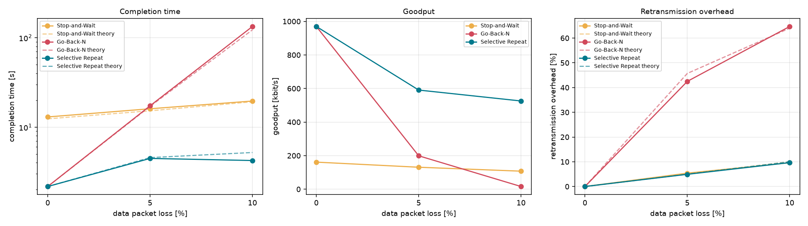
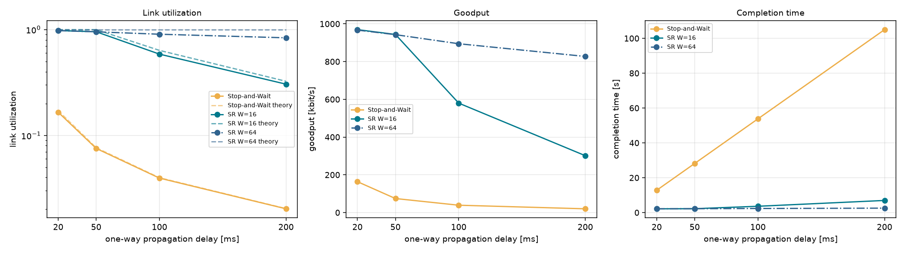
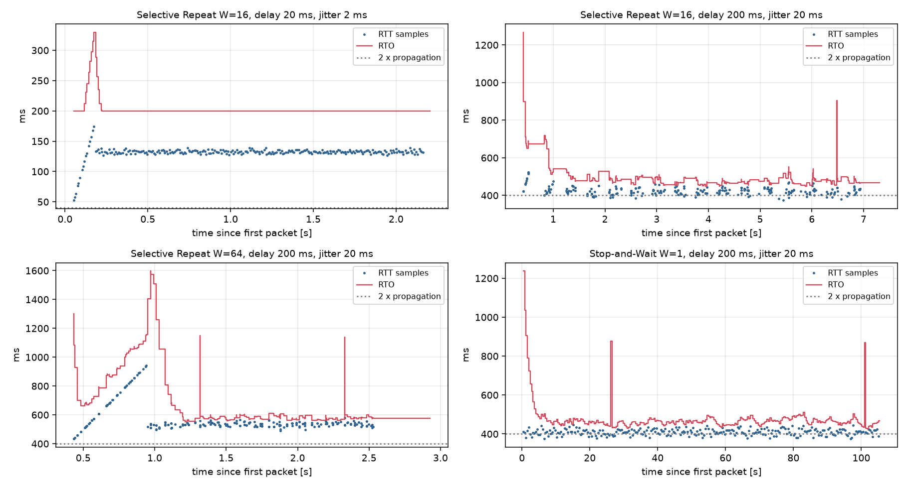
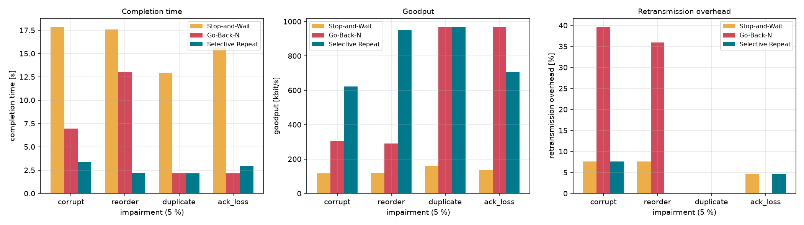
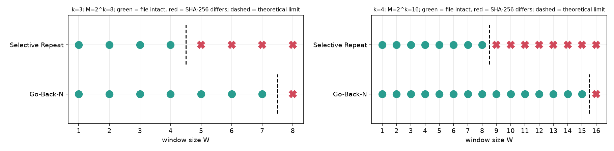

# BLG337E Project 1 — Reliable File Transfer over UDP

**Team:** [names, student IDs]  **Course:** BLG337E Principles of Computer Communications

All numbers below come from `results/summary.txt` / `results/metrics.csv`, which `scripts/analyze.py` computes from the logs in `logs/`. Every run is reproducible with `scripts/run_experiments.py` (parameters, seeds and scenario files are stored per run in `logs/exp<N>/<run>/`).

---

## 1. Design summary

Three separate C programs communicate only through UDP on 127.0.0.1: `sender → emulator → receiver` for DATA/FIN and the reverse path for ACK/FIN_ACK. The ARQ protocol (Stop-and-Wait, Go-Back-N, Selective Repeat), window `W`, sequence-number width `k`, payload size, RTO bounds, impairments and seeds are all runtime parameters (see `readme.md`).

### 1.1 Packet format

Fixed 12-byte big-endian header followed by the payload:

| bytes | field | meaning |
|---|---|---|
| 0 | type | 1 DATA, 2 ACK, 3 FIN, 4 FIN_ACK |
| 1 | flags | reserved (0) |
| 2–3 | payload_len | bytes after the header |
| 4–7 | number | DATA: seq; ACK: ack number; FIN: seq after the last DATA; FIN_ACK: copy of FIN's number. Counted mod 2^k, field always 32 bits |
| 8–11 | crc32 | CRC-32 (IEEE 802.3, own table-driven implementation, no zlib) over header (crc = 0) + payload |

FIN/FIN_ACK are added to the mandatory DATA/ACK so that the end of the transfer is reliable: the sender must know that the receiver has the whole file, and the receiver must know that no more data follows.

### 1.2 Protocols

Let `M = 2^k`. The sender keeps 64-bit absolute packet indices; only `idx mod M` goes on the wire.

* **Stop-and-Wait / Go-Back-N.** The receiver accepts only the next expected packet and answers *every* DATA packet with a cumulative ACK (= seq of the next expected packet). The sender has one timer, restarted when the base advances; on timeout it retransmits the whole window. Stop-and-Wait is GBN with `W = 1`. A cumulative ACK with `δ = (ack − base) mod M` is new if `1 ≤ δ ≤ in-flight`, duplicate if `δ = 0`, otherwise stale.
* **Selective Repeat.** The receiver accepts packets with `(seq − expected) mod M < W`, buffers out-of-order ones, delivers in order and answers each with an individual ACK. Packets in the previous window (offset ≥ `M − W`) are re-acknowledged because their ACK may have been lost. The sender keeps one timer per packet and retransmits only the expired packet.
* **Termination.** After the last ACK the sender sends FIN (number `N mod M`) and retransmits it until FIN_ACK arrives. The receiver answers FIN only if all data has been delivered, writes the file and lingers (default 2 s) so that a retransmitted FIN whose FIN_ACK was lost is still answered.

State machines:

### 1.3 RTO estimator

RFC 6298: first sample `SRTT = R`, `RTTVAR = R/2`; afterwards `RTTVAR ← ¾·RTTVAR + ¼·|SRTT − R|`, `SRTT ← ⅞·SRTT + ⅛·R`; `RTO = SRTT + 4·RTTVAR`, clamped to [200 ms, 8 s], initial 1 s.
*Karn's rule:* a packet that was retransmitted never yields an RTT sample (the ACK could belong to either copy). On timeout the RTO doubles and stays doubled until the next valid sample. For cumulative ACKs the sample is taken from the last newly acknowledged packet; for SR from the individually acknowledged packet.
*Justification:* the estimator must follow RTTs that range from 40 ms to over 900 ms (queueing in experiment 3) without a hand-tuned constant; Karn and backoff prevent spurious-retransmission spirals. The 200 ms floor avoids timeouts caused by the first window queueing behind itself at 1 Mbit/s (with the floor at 100 ms we observed 2 spurious retransmissions in a loss-free run).

### 1.4 Emulator

Each direction has its own queue (tail drop, 128 packets), serialization delay `8·len/rate`, propagation delay and jitter `U[−j, +j]` (clamped so the order is preserved). `data_loss` drops DATA only, `ack_loss` drops ACKs only (FIN/FIN_ACK are not randomly lost, so that runs terminate). Corruption flips one random bit, duplication delivers a copy right after the original, reordering holds a packet until the next packet of the same direction has been delivered. One PRNG (splitmix64/xorshift64\*) seeded from the scenario/CLI seed makes all random decisions, with a fixed number of draws per packet. Per-packet actions (`action drop data 12`, `action delay ack 30 200`, …) apply once to the first packet with that on-wire number.

---

## 2. Methodology and metrics

Test file: `testdata/input.bin`, 262 144 bytes (N = 256 packets of 1024 B), used unchanged in all runs. Baseline: 1 Mbit/s per direction, 128-packet queues, 20 ms delay each way, no impairments, k = 7, W = 16, payload 1024. Experiments 2–4 are random and were run with seeds 1, 2, 3 (tables show the mean); experiments 1 and 5 are deterministic. Runs execute 4–6 in parallel on one machine; each uses its own ports. Deviations from the PDF: none except the settings required by experiment 5 (`--unsafe --max-retx 5 --rto-max 1000`, so that failing transfers terminate quickly).

Metric definitions (exactly as computed in `scripts/analyze.py`):

* **Completion time** — from the first DATA transmission to the last "new" ACK that acknowledges the last DATA packet (sender log).
* **Goodput** — file size · 8 / completion time.
* **Retransmission overhead** — retransmitted DATA bytes / all transmitted DATA bytes (bytes = payload + 12 B header, counted at the sender).
* **Link utilization** — (first-time DATA bytes · 8 / link rate) / completion time.
* **Integrity** — SHA-256 of the received file equals the input's (stored in `meta.json`).
* **RTT / RTO** — `rtt_us` of RECV_ACK events and `rto_us` of sender events.

Notation: `t_d = (1024 + 12)·8 / 10⁶ = 8.288 ms`, `t_a = 12·8/10⁶ = 0.096 ms`, one-way delay `d`, `prop = 2d`, `C = t_d + t_a + prop` (one cycle), `N = 256`.

---

## 3. Experiment 1 — ideal network

**Derivation.** Stop-and-Wait sends one packet per cycle: `T_SW = N·C = 256 · 48.384 ms = 12.39 s`, utilization `t_d/C = 0.171`. With a window of `W` packets, `W` packets are acknowledged per cycle while the pipe is not full: `T(W) = ⌈N/W⌉·C`, utilization `W·t_d/C`. The pipe is full when `W ≥ W* = C/t_d = 5.84`, i.e. `W = 6`; beyond that the link is the bottleneck and `T = N·t_d + prop + t_a = 2.162 s`. Because the file is finite, the best achievable utilization is `N·t_d / T = 0.981`, not 1: the last packet still needs `prop + t_a` to be acknowledged. GBN and SR behave identically here because nothing is lost.

| proto | W | T measured [s] | T theory [s] | goodput [kbit/s] | util meas | util theory (pipe model) |
|---|---|---|---|---|---|---|
| SW | 1 | 12.978 | 12.386 | 161.6 | 0.163 | 0.171 |
| GBN | 1 / 2 / 4 | 12.979 / 6.397 / 3.226 | 12.386 / 6.193 / 3.097 | 161.6 / 327.8 / 650.1 | 0.163 / 0.332 / 0.658 | 0.171 / 0.343 / 0.685 |
| GBN | 8 / 16 / 32 | 2.163 | 2.162 | 969.5 | 0.981 | 0.981 (max) |
| SR | 1 / 2 / 4 | 12.981 / 6.394 / 3.239 | 12.386 / 6.193 / 3.097 | 161.6 / 328.0 / 647.5 | 0.163 / 0.332 / 0.655 | 0.171 / 0.343 / 0.685 |
| SR | 8 / 16 / 32 | 2.163 / 2.163 / 2.179 | 2.162 | 969.6 / 969.3 / 962.4 | 0.981 / 0.981 / 0.974 | 0.981 (max) |

**Interpretation.** Measurements match the model: throughput grows linearly with `W` up to `W* ≈ 6` and saturates at the link rate (≈ 970 kbit/s of 1 Mbit/s; the rest is the 12-byte headers, 1.2 %, and the finite-file tail). Below `W*` the measured time is 3–5 % above theory (≈ 2.3 ms per cycle), which we attribute to timer/scheduling granularity of `poll()` and process hand-offs on loopback (not measured separately). SR with W = 32 had 2 retransmissions: the queue of the first window pushes RTT up faster than the estimator's RTO follows, a spurious timeout.

---

## 4. Experiment 2 — packet loss

**Derivation.** Let `p` be the data loss probability and `L = N·p/(1−p)` the expected number of loss events.
*Stop-and-Wait:* each packet needs `1/(1−p)` attempts, every failed attempt costs an RTO instead of a cycle: `T = N·(C + p/(1−p)·RTO)`; retransmission overhead `= p`.
*Selective Repeat:* only the lost packet is repeated, so `N/(1−p)` packets are sent: `T ≈ N·t_d/(1−p) + L·max(0, RTO − W·t_d) + prop + t_a` (the sender stalls only once the window is full, `W·t_d` after the loss, until the RTO fires); overhead `= p`.
*Go-Back-N:* after a loss all packets sent until the timer fires are discarded, so the link is wasted for one RTO per loss: `T ≈ N·t_d + L·RTO + prop + t_a`. A loss makes the sender repeat about `W` packets, so a fraction `1 − (1−p)/(1+(W−1)p)` of the transmitted bytes are retransmissions. The RTO used in the formulas is the measured mean RTO at the moments timeouts fired (it grows through backoff).

| proto | loss | T meas [s] | T theory [s] | goodput [kbit/s] | overhead meas | overhead theory | timeouts |
|---|---|---|---|---|---|---|---|
| SW | 0 % | 13.00 | 12.39 | 161.3 | 0 | 0 | 0 |
| SW | 5 % | 16.06 | 15.23 | 130.9 | 0.054 | 0.050 | 14.7 |
| SW | 10 % | 19.60 | 19.23 | 107.4 | 0.096 | 0.100 | 27.3 |
| GBN | 0 % | 2.16 | 2.16 | 969.5 | 0 | 0 | 0 |
| GBN | 5 % | 17.33 | 17.09 | 199.0 | 0.425 | 0.457 | 12.0 |
| GBN | 10 % | 134.00 | 122.91 | 16.0 | 0.647 | 0.640 | 30.7 |
| SR | 0 % | 2.16 | 2.16 | 969.4 | 0 | 0 | 0 |
| SR | 5 % | 4.46 | 4.56 | 590.7 | 0.049 | 0.050 | 13.3 |
| SR | 10 % | 4.23 | 5.20 | 525.6 | 0.097 | 0.100 | 27.7 |

**Interpretation.** SR pays only the retransmission of the lost packet (overhead ≈ `p`), and the pipeline keeps the link busy until the window fills; GBN throws away a whole window per loss (overhead 42 % at 5 %, 65 % at 10 %) and is idle for an RTO each time. Because a retransmitted window is itself lost with probability `1 − (1−p)^W` (≈ 56 % at p = 5 %, 81 % at 10 %), GBN repeatedly times out; the RTO doubles on each timeout and only returns to the estimate when a non-retransmitted packet is acknowledged, which rarely happens — hence 134 s at 10 % loss, far worse than Stop-and-Wait (19.6 s). The theory reproduces the ranking and the magnitudes (within 5–10 % for SW, GBN; SR at 10 % is 18 % pessimistic because the window usually refills before the RTO fires, which the formula ignores). SR at 10 % being slightly faster than at 5 % is within seed-to-seed variation (3 seeds).

---

## 5. Experiment 3 — propagation delay

**Derivation.** One cycle is `C = t_d + t_a + 2d`. A window of `W` packets keeps the link busy iff `W·t_d ≥ C`, i.e. `W ≥ W*(d) = C/t_d`: for `d` = 20, 50, 100, 200 ms, `W*` = 5.8, 12.1, 24.3, 49.3. Utilization is `U = min(1, W·t_d/C)`, and for the finite file at best `N·t_d/(N·t_d + 2d + t_a)`, e.g. 0.841 at d = 200 ms. Stop-and-Wait (`W = 1`): `U = t_d/C = 0.171 … 0.020`.

| proto | W | d [ms] | T [s] | goodput [kbit/s] | util meas | util theory (`min(1, W t_d/C)`) | mean RTT [ms] | mean RTO [ms] | timeouts |
|---|---|---|---|---|---|---|---|---|---|
| SW | 1 | 20 / 50 / 100 / 200 | 12.81 / 28.19 / 53.81 / 104.99 | 163.7 / 74.4 / 39.0 / 20.0 | 0.166 / 0.075 / 0.039 / 0.020 | 0.171 / 0.076 / 0.040 / 0.020 | 50 / 110 / 210 / 410 | 203 / 204 / 248 / 480 | 0 / 0 / 1 / 0.7 |
| SR | 16 | 20 / 50 / 100 / 200 | 2.16 / 2.22 / 3.62 / 6.96 | 969 / 944 / 580 / 301 | 0.981 / 0.955 / 0.587 / 0.305 | 1.0 / 1.0 / 0.636 / 0.325 | 131 / 135 / 220 / 425 | 230 / 237 / 293 / 524 | 0 / 0 / 2 / 2 |
| SR | 64 | 20 / 50 / 100 / 200 | 2.17 / 2.22 / 2.34 / 2.54 | 967 / 943 / 895 / 827 | 0.978 / 0.954 / 0.905 / 0.837 | 1.0 / 1.0 / 1.0 / 1.0 | 476 / 491 / 517 / 570 | 592 / 616 / 669 / 763 | 1.3 / 0.3 / 2 / 1.7 |

**Interpretation.** Utilization follows `min(1, W·t_d/C)`: SR W = 16 saturates at d ≤ 50 ms (W* ≤ 12) and falls to ≈ 0.3 at 200 ms, where `W* = 49`; W = 64 ≥ W* stays near the finite-file bound (0.837 vs 0.841 at 200 ms). The measured RTT in W = 64 runs (≈ 480–570 ms, even at d = 20) is far above `2d` because the 64-packet window queues in the emulator at 8.3 ms per packet: in steady state the queue holds `W − BDP` packets.

**RTO tracking** (`plot/exp3_rto_tracking.png`):

The RTO starts at 1 s (initial value), drops within a few RTT samples and settles at `SRTT + 4·RTTVAR`, i.e. 50–150 ms above the RTT cloud (e.g. ≈ 470 ms over RTT samples of 400–440 ms at d = 200 ms). Isolated spikes are timeouts (RTO doubled, then pulled back by the next valid sample). The W = 64 panel shows the RTT ramping from 430 to 940 ms while the initial burst fills the queue; the RTO follows it upward (to 1.6 s) and then drops once the queue has drained to its steady-state level. Throughout the run the RTO stayed above the measured RTT except for the short burst at start, where it lagged and caused the 1–2 spurious timeouts per run.

**Go-Back-N (not run).** Without loss, GBN with the same `W` would give the same utilization as SR, since the pipe model is identical (and jitter never reorders packets in our emulator). It would be clearly worse wherever a timeout fires: SR runs at W = 64 had 1–2 spurious timeouts (RTO lagging the RTT growth), each costing SR one packet but costing GBN a whole window of up to 64 packets, plus a doubled RTO. We would therefore expect GBN ≈ SR at 20–50 ms and visibly lower goodput at W = 64 and large delays; it would also be more exposed to a larger `RTO`/RTT mismatch at start-up.

---

## 6. Experiment 4 — corruption, reordering, duplication, ACK loss (5 % each)

All 36 runs delivered the file intact (SHA-256 equal).

| impairment | proto | T [s] | goodput [kbit/s] | retx overhead | timeouts | receiver bad-CRC | receiver duplicates |
|---|---|---|---|---|---|---|---|
| corruption | SW | 17.87 | 117.4 | 0.076 | 21.0 | 10.3 | 11.0 |
| | GBN | 6.96 | 304.4 | 0.397 | 10.7 | 16.0 | 153.0 |
| | SR | 3.40 | 620.9 | 0.076 | 21.0 | 10.0 | 11.3 |
| reordering | SW | 17.60 | 119.3 | 0.076 | 21.0 | 0 | 21.0 |
| | GBN | 13.02 | 289.3 | 0.360 | 9.7 | 0 | 151.0 |
| | SR | 2.20 | 952.5 | 0.001 | 0.3 | 0 | 0.3 |
| duplication | SW | 12.96 | 161.9 | 0 | 0 | 0 | 12.0 |
| | GBN | 2.16 | 969.4 | 0 | 0 | 0 | 11.3 |
| | SR | 2.16 | 969.6 | 0 | 0 | 0 | 11.3 |
| ACK loss | SW | 15.63 | 134.2 | 0.047 | 12.7 | 0 | 12.7 |
| | GBN | 2.16 | 969.3 | 0 | 0 | 0 | 0 |
| | SR | 2.99 | 706.2 | 0.047 | 12.7 | 0 | 12.7 |

**Interpretation, per impairment.**

* *Corruption.* The CRC turns a corrupted packet into a loss (the receiver drops it silently; corruption hitting an ACK is detected the same way by the sender). Costs are those of loss: SW one RTO per event; GBN a whole window (overhead 0.40); SR only the damaged packet (0.076, same as SW — one packet per event).
* *Reordering.* A held packet arrives after its successor. SR buffers the successor and ACKs it, so the reordered packet is simply delivered a little later (T ≈ baseline, 0.3 timeouts). GBN discards the out-of-order successor and answers with duplicate ACKs, so a reordered packet looks like a loss: the sender only learns after the RTO (≈ 10 timeouts, 13 s) and retransmits the window. SW also needs an RTO (the held packet is released only by the retransmission).
* *Duplication.* Duplicates are recognised by sequence number (GBN/SW: not the expected number, answered with the current cumulative ACK; SR: `have[seq]` already set) and ignored. No timeouts and no retransmissions; the only cost is the receiver's extra processing. Completion time equals the baseline for all three.
* *ACK loss.* GBN's cumulative ACKs are redundant: a later ACK acknowledges everything earlier, so a lost ACK costs nothing at W = 16 (T = 2.16 s, no timeouts). SR's individual ACKs are not redundant: a lost ACK leaves the packet unacknowledged until its RTO fires, the sender retransmits a packet the receiver already has, and the receiver re-ACKs it (overhead 0.047 = ACK-loss rate). In SW every lost ACK costs an RTO, but no more than one packet per event.

---

## 7. Experiment 5 — sequence-number limits

**Derivation of the largest window.**

*Go-Back-N: `W ≤ 2^k − 1`.* The receiver only reports the next expected sequence number. If `W = M` and a full window of `M` packets is delivered, the ACK number equals `base mod M` — exactly the value of a duplicate ACK ("nothing new"). The sender cannot distinguish "all `M` packets received" from "none received". With `W ≤ M − 1` the number of newly acknowledged packets `δ = (ack − base) mod M` lies in `1 … M−1` and is unambiguous.

*Selective Repeat: `W ≤ 2^(k−1)`.* After the receiver has delivered a window, its window covers sequence numbers `[exp, exp + W)` and the previous window `[exp − W, exp)` (whose ACKs may have been lost, so retransmissions of them must be recognised). Both ranges must be disjoint mod `M`: `2W ≤ M`. For `W > M/2` a retransmitted old packet falls inside the new window and is accepted as new data.

**Setup (deterministic, per-packet actions).** For k = 3 (M = 8) and k = 4 (M = 16), every `W = 1 … M`, `--unsafe` to bypass the sender's limit check:
* GBN: the first ACKs numbered 1 … M−1 are dropped (`action drop ack n`). Only for `W = M` is the surviving ACK 0 (= M mod M) ambiguous: the sender treats it as a duplicate, times out, retransmits packet 0, and the receiver (expecting seq 0 again) accepts it as new data.
* SR: the first ACK numbered 0 is dropped. For `W > M/2` the retransmitted packet 0 is accepted into the new window and the real packet `M` (also seq 0) is then discarded as a duplicate.

The same impairment is applied for all windows of a protocol and `k`.

| k | protocol | theoretical limit | windows with intact file | windows with different SHA-256 |
|---|---|---|---|---|
| 3 | GBN | 7 | 1–7 | 8 |
| 3 | SR | 4 | 1–4 | 5, 6, 7, 8 |
| 4 | GBN | 15 | 1–15 | 16 |
| 4 | SR | 8 | 1–8 | 9–16 |

The experiment confirms the derivations exactly, for both values of k. The SHA-256 of every failed run's received file differs from the input's (`meta.json`: `sha_in` vs `sha_out`; failed outputs are kept as `out.bin`). Some failed GBN runs also end with the sender giving up (FIN never accepted because the receiver's position is off), which is another symptom of the same fault.

---

## 8. Failure conditions and limitations

* **Window limits** (section 7): W ≤ 2^k − 1 (GBN), W ≤ 2^(k−1) (SR). Outside them the transfer silently produces a wrong file, which the sender cannot detect; only `--unsafe` allows such values. The analysis also assumes that delayed packets do not live longer than a few windows: a packet delayed by more than `M/W` windows (e.g. through large `action delay` values) can be mistaken for a new packet, exactly like an old TCP segment after wraparound.
* **Persistent backoff.** Because RTO backoff is kept until a non-retransmitted packet is acknowledged, GBN at 10 % loss and W = 16 hardly ever resets it (134 s). Limiting backoff or sampling retransmissions (e.g. with timestamps) would fix this but was out of scope.
* **Start-up timeouts.** The first window is queued behind itself at 1 Mbit/s, so RTT grows faster than the estimator follows; 1–2 spurious timeouts at large windows (W = 32 / 64).
* **Termination.** FIN / FIN_ACK are exempt from the emulator's random loss; the sender aborts after `--max-retx` (30) retransmissions of one packet; a receiver whose FIN_ACK is lost still answers for `linger` ms (2 s by default).
* **Scope.** Loopback only, no flow or congestion control, one transfer per run, file is read fully into memory, emulator rate counts only the UDP payload (no IP/UDP headers). Timings on a shared machine show a few percent of scheduling noise (see experiment 1).

---

## 9. Division of work

[Team members: fill in who did what — e.g. protocol design, sender, receiver, emulator, scripts, experiments, report.]

---

## 10. AI use statement

Tool: **Claude Code (Anthropic, model Claude Sonnet 5.5)**, used in the editor.

What the tool did in this project: it wrote the first versions of the sender, receiver and emulator source code and of the packet/CRC module (`config/packet.c`), the experiment runner and analysis scripts (`scripts/`), the README and the first draft of this report (including the derivations and the interpretation of the measured results). It also ran the builds, the transfers and the experiments in the development environment and checked the outputs.

What the team did: [to be completed by the team truthfully — for example: specified the assignment and decisions, reviewed and tested the code, ran/re-ran the experiments, checked the derivations and wrote or edited the report, performed the demo].

The team is responsible for the correctness, reproducibility and originality of the submission.
